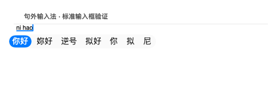
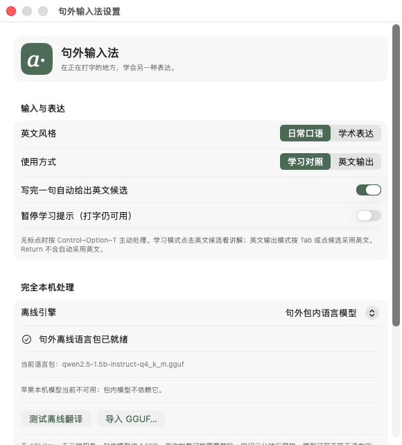

# 句外 Aside

**在正在打字的地方，学会另一种表达。**

句外是一款 macOS 输入法：中文整句翻译、英文整句改写，附中文讲解。日常口语与学术表达二选一，目标是在百度搜索框、微信聊天框等现有输入框里使用。

## 当前进度

**0.3 输入法版本正在回归验证，尚未发布新版 DMG。** 原生安装、两个系统输入模式、拼音和英文实际按键输入、离线生成已有 macOS CI 记录；最新词语提交行为与网页兼容性仍在检查。旧版 0.2 编辑器安装包不包含此输入法。

[构建结果](https://github.com/pengruoxin/Aside/actions/workflows/macos.yml) · [已发布版本](https://github.com/pengruoxin/Aside/releases)

当前面向 **Apple Silicon、macOS 26+**，优先适配 13 英寸 MacBook Air（M5、16GB）。苹果拼音和 ABC 可以保留，选中句外输入源时才提供句外功能。拼音引擎使用 Rime，操作尽量遵循 macOS，候选排序不会与苹果拼音完全相同。

## 日常使用

| 操作 | 行为 |
|---|---|
| 句外拼音 | 空格、数字选词，累积成句；中文整句翻译 |
| 句外英文 | 正常输入英文，整句改写并给出中文讲解 |
| 口语 / 学术 | 设置中二选一，每次只显示一个版本 |
| 句末停顿 | 自动处理完整句子，不逐词翻译 |
| Control–Option–T | 手动处理当前句子，适合没有句号的搜索词 |
| Return | 有拼音时先确认；无拼音时提交原文，交回应用搜索或发送 |
| 学习对照 | 保持原文，点击英文候选看中文讲解 |
| 英文输出 | 英文候选就绪后按 Tab 或点击，明确采用英文 |
| Esc | 取消当前拼音或隐藏学习提示 |
| 输入源切换 | 使用 macOS 已配置的地球键、Control–空格、Caps Lock 等设置 |

**译文显示在原生输入法候选区。** 当前没有实现所有应用通用的输入框内浅灰英文；译文不混进搜索词或聊天正文，不自动发送。模型未就绪或处理失败时仍可输入原文。每次最多处理 600 字；超长内容保留原文，不静默截断后翻译。

选好的词立即落入原输入框，后台累积整句。普通退格尽量保留前文；移动光标、粘贴或切换输入框后，当前学习上下文重新开始。采用英文前会核对原文和位置；无法核对的输入框保留原文。

## 原生界面

以下为 macOS 自动测试中截取的真实界面；输入框是测试宿主，不随安装包提供编辑器。





## 完全离线

完整包内置 Rime、Luna Pinyin 词典、llama.cpp 与 Qwen2.5-1.5B-Instruct Q4_K_M 模型（约 1.1GB），安装后不需要 API Key、Ollama 或 Homebrew。模型在本机运行，只绑定本机回环地址并使用临时令牌，不向外部翻译服务发送原文。

设置也提供苹果本机模型选项，需要 Apple Intelligence 实际可用。默认使用包内模型，不依赖苹果本机模型的地区或账户条件。可从可信来源导入兼容 GGUF。小模型可能误译，学术风格和讲解质量仍需人工检查。

不保存全部输入历史、不记录原文日志、不读取其他应用的聊天记录。Rime 会在本机维护选词学习数据；只有当前由句外输入的组合文本用于学习提示。

## 安装方式

新版发布后，打开 DMG 内的“安装句外”，安装器将输入法放入当前用户的 `~/Library/Input Methods/Aside.app` 并注册。它不是拖入 Applications 的独立编辑器。若输入菜单没有出现，请在系统设置 → 键盘 → 文本输入 → 编辑中添加句外，必要时退出登录后重新登录。

升级前切换到 ABC 或苹果拼音。安装器暂存并验证新包，备份原包后替换；升级后需要退出登录再登录以加载新版本。完整包内含模型，可以断网测试。

目前没有 Apple Developer ID 签名或公证。系统可能要求在“隐私与安全性”中确认打开，无需关闭安全保护。

## 构建与验证

在 Apple Silicon Mac、macOS 26+、Xcode / Command Line Tools 环境中：

```sh
brew install librime cmake
ASIDE_INCLUDE_MODEL=1 bash scripts/build-ime.sh
bash scripts/package-dmg.sh
```

构建阶段联网下载固定版本的词典、推理程序和模型，模型校验 SHA-256；安装后不需要这些构建依赖。完整包仅在检查全部通过后生成至 `dist/Aside-0.3.0-arm64-offline.dmg`。CI 轻量构建不含模型，不能作为完整离线安装包。

CI 检查核心逻辑、安装失败回滚、Rime 实际选词、本机离线生成、标准原生与 WebKit 输入控件、系统输入源注册和切换。**标准控件测试不等于百度、微信已经验收。** Windows 开发环境无法代替目标 Mac 的实际使用测试。详见 [验证记录](docs/verification.md)。

## 源码与许可

- `Sources/AsideInputMethod`：系统输入法、按键与原生候选区。
- `Sources/AsideOffline`：本机模型、原生设置、共享偏好。
- `Sources/AsideInstaller`：当前用户输入法安装器。
- `Sources/AsideCore`：句子状态、返回校验、安装事务。
- `Sources/RimeBridge`：librime C 接口。
- `Sources/AsideHostHarness`：不随安装包分发的测试控件。

句外代码为 MIT；librime 为 BSD，Luna Pinyin / Rime Essay 数据为 LGPL-3.0，llama.cpp 为 MIT，Qwen 模型为 Apache-2.0。安装包包含对应许可证与词典源文件。旧版编辑器截图和文档仅代表历史版本。
