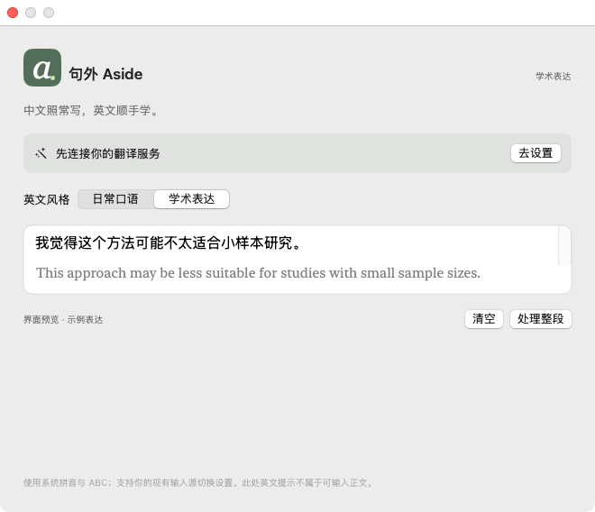
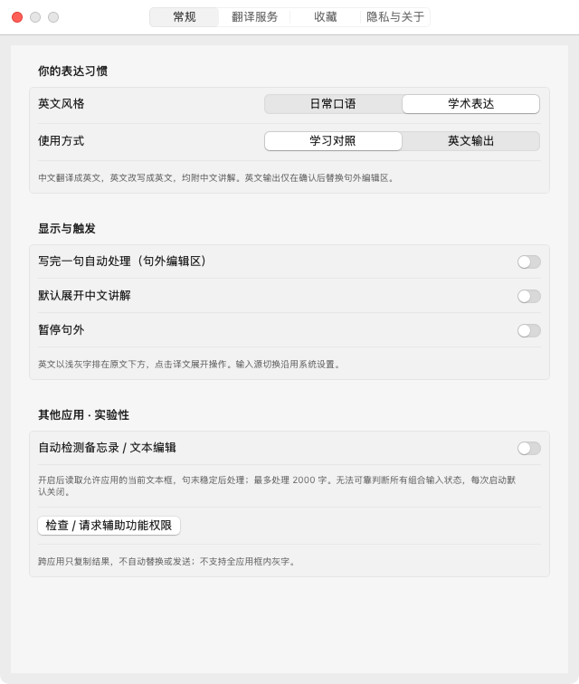
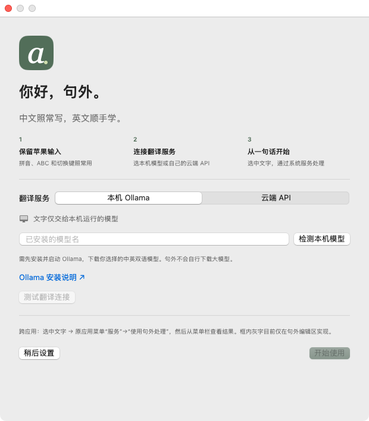

# 句外 Aside

**中文照常写，英文顺手学。**

原生 Mac 英语学习助手，保留苹果自带拼音与 ABC。

[](https://github.com/pengruoxin/Aside/actions/workflows/macos.yml)

## 下载安装

**[下载 M 系列 Mac 版](https://github.com/pengruoxin/Aside/releases/download/v0.2.0/Aside-0.2.0-arm64.dmg)** · **[下载 Intel Mac 版](https://github.com/pengruoxin/Aside/releases/download/v0.2.0/Aside-0.2.0-x86_64.dmg)** · [全部版本](https://github.com/pengruoxin/Aside/releases)

1. 关于本机显示 Apple M 系列选 arm64，显示 Intel 选 x86_64。
2. 打开 DMG，把 Aside 拖入 Applications，再从 Applications 打开。
3. 菜单栏出现“句外”表示已运行。在首次引导中配置翻译服务，再点“测试翻译连接”。

**应用可直接安装启动，但不内置模型、免费 API 额度或服务账户。翻译前需选择以下一种服务：**

- **本机 Ollama**：安装并启动 [Ollama](https://ollama.com/download/mac)，自行安装中英双语模型，在句外点“检测本机模型”选择。
- **云端 API**：填写 HTTPS API 基础地址、模型名和自己的 API Key，支持 Chat Completions JSON 模式。密钥按地址存入 Mac 钥匙串。

这是 **v0.2.0 预览版，尚无 Apple Developer ID 签名与公证**。首次打开若被系统阻止，请核对本仓库 Release 来源，再到系统设置 → 隐私与安全性中选择“仍要打开”。无需关闭 Gatekeeper，不要运行停用安全保护的命令。下载页提供 SHA-256 校验文件。

## 日常使用

中文继续用苹果拼音，英文继续用 ABC。句外不重新实现拼音、不更改 Caps Lock、地球键、Control–空格或你已配置的输入源切换习惯。

**其他应用：** 选中一句中文或英文，从原应用菜单“服务 → 使用句外处理”，再点菜单栏句外查看和复制结果。部分应用也支持“读取当前应用选中文字”，需要辅助功能授权。

服务菜单未出现时，可在系统设置 → 键盘 → 键盘快捷键 → 服务中检查，并按个人习惯分配系统服务快捷键。自定义编辑器可能不提供系统服务或标准选区，此时复制到句外编辑区。

**句外原生编辑区：** 正常输入中文或英文，完整内容在句末稳定后处理，或手动点“处理整段”。英文以浅灰字排在原文下方。点击译文查看讲解、复制或收藏；“英文输出”允许主动确认替换，并支持原生撤销。

**目前第三方应用不支持通用框内灰字。** 框内提示只在句外自己的原生编辑区实现。跨应用不自动替换、发送或模拟退格；备忘录与文本编辑的自动检测仍为实验功能，默认关闭。

## 功能

| 选择 | 行为 |
|---|---|
| 中文输入 | 翻译成英文，附中文讲解 |
| 英文输入 | 改写英文，附中文讲解 |
| 日常口语 / 学术表达 | 二选一，每次只展示一个版本 |
| 学习对照 / 英文输出 | 保留原文，或主动替换句外编辑区 |
| 自动 / 手动 | 句末稳定后处理，不逐词展示零碎翻译 |
| 收藏 | 只保存主动收藏的句子，可回看、复制、移除 |
| 暂停与清空 | 暂停处理，或清除当前原文和结果 |

最多处理 2000 字，超限不静默截断。表达要求保留原文事实、否定与不确定性；模型仍可能出错，请检查结果。

## 原生界面

以下为 GitHub Actions 中实际运行的 macOS 程序截图，译文使用展示示例。





## 隐私

- 默认连接本机 Ollama；云端模式向你配置并同意的 HTTPS 服务发送当前处理内容和表达要求。
- 云端同意本次运行有效，更改地址后需重新确认。API Key 不写入仓库或偏好文件。
- 不监听全局键盘，不自动保存全部输入历史。仅主动收藏的句子保存在本机。
- 安全密码控件不参与读取；自动检测仅限明确允许的应用与控件。
- 编辑、暂停、改变设置或切换来源会取消旧请求；手动选区结果不会被自动检测失败误清空。
- 本客户端不记录原文日志；服务商的数据规则和费用请自行确认。

## 构建与测试

目标 macOS 13+，无第三方依赖，需 Xcode / Command Line Tools。

```sh
git clone https://github.com/pengruoxin/Aside.git
cd Aside
bash scripts/build-macos.sh
bash scripts/package-dmg.sh
open dist/Aside.app
```

CI 在 Apple Silicon 与 Intel 的 macOS 15 上分别执行单元测试、release 构建、原生启动 / 编辑 / 撤销检查、界面截图、DMG 校验。推送版本标签后，两个架构均成功才发布 Release。

测试使用模拟服务，不需要真实密钥。**macOS 13 是部署目标，目前 CI 验证环境为 macOS 15。** 自动测试不等于所有系统版本、苹果拼音候选交互和第三方应用已实测。详见 [兼容性清单](docs/compatibility.md) 与 [验证记录](docs/verification.md)。

## 项目结构

- `Sources/Aside`：原生窗口、菜单栏、设置、输入、辅助功能与钥匙串。
- `Sources/AsideCore`：句界、语言判断、服务协议及请求校验。
- `Tests/AsideCoreTests`：确定性测试，不使用真实 API Key。
- `scripts`：图标、构建、DMG 打包。
- `.github/workflows/macos.yml`：双架构验证与版本发布。

尚未提供正式签名 / 公证、全应用框内提示、外部自动替换、登录启动或自动更新。[反馈问题](https://github.com/pengruoxin/Aside/issues) 时请附系统版本、应用版本和复现步骤。

MIT License，沿用仓库原有许可证。
