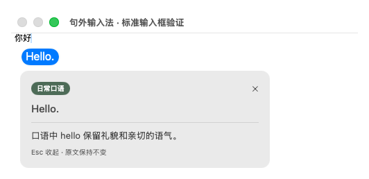

# 0.3 输入法验证记录

目标：13 英寸 MacBook Air、M5、16GB、macOS 26.5.1。开发主机为 Windows；自动验证运行在 GitHub Actions 的 macOS 26 ARM64 主机。

## 已有证据

**发布构建 [40998598138](https://github.com/pengruoxin/Aside/actions/runs/40998598138) 已全部通过，已发布 [v0.3.0](https://github.com/pengruoxin/Aside/releases/tag/v0.3.0) 完整离线测试版。** 标签源码为 `1086c15`。此前完整构建 [40995545066](https://github.com/pengruoxin/Aside/actions/runs/40995545066) 验证 `7d104f8`；发布版本随包输入法代码与其一致，仅测试宿主的就绪条件有修正。

- 25 项核心测试通过，包含整句累积、过期结果、UTF-16 替换范围、空白保留、安装回滚。
- 实际安装器、系统输入源冷启动、两种模式、空格确认与原生双击选词通过。
- 包内真实模型完成中文翻译、英文改写及中文讲解；原生讲解窗口确实可见，并已人工核对截图。
- 生成期间正文保持原样；双击看讲解、Tab 采用英文、Return 交给应用且只提交一次均通过。
- WebKit 搜索/聊天输入与提交通过；两个输入框文字和光标相同，换框后旧译文仍不能被采用。
- 完整模型 DMG 生成与 `hdiutil verify` 通过；安装器、输入法及随包依赖通过本机签名完整性检查。这不等于 Developer ID 签名或 Apple 公证。

主分支 `1086c15` 的[轻量回归 40997819180](https://github.com/pengruoxin/Aside/actions/runs/40997819180) 已通过。该提交只修正测试宿主的就绪判断：系统已选中句外时，允许 macOS 在第一个按键才启动输入法；最终输入内容的断言保持不变，不修改随包输入法代码。

已核对公开 DMG 下载地址返回 HTTP 200、文件大小为 1,129,485,513 字节。下载的校验文件与 GitHub 发布资产记录的 SHA-256 一致：`ea043cfaca6c64685577cc683a5ca137c18f9ac690569dc0a5a40f7aea929b71`。Windows 主机未运行 DMG；镜像完整性与安装流程的执行证据来自上述 macOS CI。

## 历史排查记录

- [40997160380](https://github.com/pengruoxin/Aside/actions/runs/40997160380)：真实模型翻译、可见讲解、Tab 采用及 WebKit 输入通过；随后因测试要求输入法进程在第一个按键之前存在而失败。未生成或发布安装包，不能作为成功发布记录；此测试条件已由 `1086c15` 修正。

- [40989619234](https://github.com/pengruoxin/Aside/actions/runs/40989619234)：最新系统模式回调、词语确认、退格、手动整句处理、不可回读客户端和 WebKit 搜索/聊天输入回归通过。两种模式使用独立“中 / A”图标。真实百度页中苹果拼音已能输入“你好”，但未观察到 Return 搜索，因此该页仍记录 UNAVAILABLE。

- [40986774181](https://github.com/pengruoxin/Aside/actions/runs/40986774181)：词语立即提交的新流程基础回归通过；核心测试、连续选词、确认后无 marked text、退格、手动整句处理、两个模式和标准 WebKit 搜索/聊天提交。百度的同页苹果拼音对照未通过，记录 UNAVAILABLE，不代表百度通过。

- 核心测试通过：整句累积、提示与正文隔离、异步版本失效、原文提交、明确采用英文、安装暂存验证与失败回滚。
- 实际 librime 引擎产生“你好”候选并正确提交。
- 标准 NSTextView 与 WebKit 搜索框、文本框的组合文本测试通过，英文提示没有混入正文。
- 完整包所用模型哈希核对通过；CI 实际执行中文翻译、英文改写并返回中文讲解。仅证明推理路径可用，不证明学术风格或翻译质量达标。
- [40845457731](https://github.com/pengruoxin/Aside/actions/runs/40845457731)：两个系统模式注册、启用、切换、冷启动及真实 IMK 按键输入通过，Return 提交一次。
- [40847152356](https://github.com/pengruoxin/Aside/actions/runs/40847152356)：实际中文翻译、英文改写、中文讲解、模型 SHA-256、签名完整性与 DMG 校验通过；该历史包未发布。
- [40848255418](https://github.com/pengruoxin/Aside/actions/runs/40848255418)：执行安装器的真实安装流程并校对运行包位置；标准搜索和聊天输入框 Return 各一次。
- [40850143052](https://github.com/pengruoxin/Aside/actions/runs/40850143052)：IMK 内离线生成期间正文不变，Tab 采用英文、Return 一次；该轮最终因百度实际页面检查失败，整体未通过。

旧记录用于追踪改动，当前验证状态以前面的完整构建为准。确认词语立即写入宿主，只保留未确认拼音的 marked text；Tab 替换核对原文、光标与 UTF-16 范围，并保留两侧空白。此前仅调用系统讲解回调不足以证明内容可见，现已改为检查实际讲解窗口并核对截图。

## 仍待实机验收

- 在目标 Mac 安装、首次加载、断网、睡眠唤醒与升级检查。
- 百度搜索框：拼音候选、无句号手动翻译、Return 搜索，不混入英文提示。
- 已登录微信：中文长句、英文改写、Return 发送一次、切换聊天对象、焦点变化、Esc、Tab、复制粘贴和撤销。
- 地球键、Control–空格、Caps Lock 遵循本机系统设置，保留苹果拼音 / ABC。

实际百度页面已加入 WebKit 在线检查，输入和提交存在不稳定表现，正在使用同页苹果拼音作对照定位；标准控件测试不等于百度已通过。页面不可访问时记录 UNAVAILABLE，不能算通过。微信、目标 M5 设备速度和长时间体验尚无实机记录，也没有 Apple Developer ID 公证。0.2 编辑器版本的成功构建不算 0.3 输入法验证结果。
